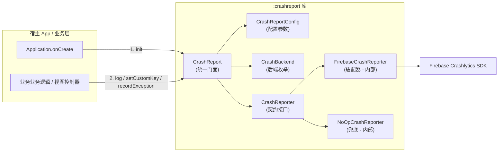
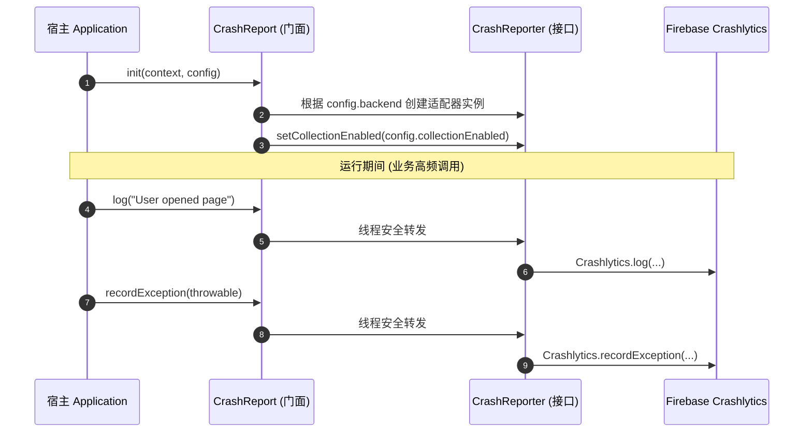

# CrashReportKit-Android

[](https://jitpack.io/#e-hai/CrashReportKit-Android)
[](LICENSE)
[](https://developer.android.com)
[](https://developer.android.com)

> **轻量级、低耦合的 Android 统一崩溃上报 SDK 门面。**  
> 业务层只需调用统一的 `CrashReport` 门面，底层上报通道具备热插拔与可替换能力（当前默认接入 **Firebase Crashlytics**）。  
> 🍏 **iOS 版本**：请访问 [CrashReportKit-iOS](https://github.com/e-hai/CrashReportKit-iOS)。

---

## 🌟 核心特性

- **统一门面模式（Unified Facade）**：全工程业务代码仅需依赖 `CrashReport`，彻底规避直接依赖第三方厂商 SDK（如 Firebase）。
- **零厂商泄漏（Zero Vendor Leakage）**：底层厂商适配器严格封装在 `internal` 作用域内，未来切换到 Sentry、Bugly 或自研 APM 时，业务调用点**零改动**。
- **隐私合规与动态采集控制（Privacy & Compliance）**：提供 `setCollectionEnabled` 动态开关，完美适配 GDPR / 国内个人信息保护合规规范，用户同意隐私协议前不上传任何数据。
- **双重安全降级（Fail-Safe & Dual No-Op）**：未初始化状态或显式设置 `enabled = false` 时，所有门面调用自动路由至 `NoOpCrashReporter`，确保监控逻辑自身绝不引发应用崩溃。
- **线程安全与双语言支持**：全门面 API 保证多线程并发安全，所有公共方法均标记 `@JvmStatic`，同时友好支持 Kotlin 与 Java 业务调用。

---

## 🏗️ 架构设计

### 模块结构与调用关系



### 运行时时序



---

## 📦 接入依赖

### 1. 配置 JitPack 仓库

#### Kotlin DSL (`settings.gradle.kts`)：
```kotlin
dependencyResolutionManagement {
    repositoriesMode.set(RepositoriesMode.FAIL_ON_PROJECT_REPOS)
    repositories {
        google()
        mavenCentral()
        maven { url = uri("https://jitpack.io") }
    }
}
```

#### Groovy DSL (`settings.gradle`)：
```groovy
dependencyResolutionManagement {
    repositoriesMode.set(RepositoriesMode.FAIL_ON_PROJECT_REPOS)
    repositories {
        google()
        mavenCentral()
        maven { url 'https://jitpack.io' }
    }
}
```

---

### 2. 添加 SDK 依赖

#### Kotlin DSL (`app/build.gradle.kts`)：
```kotlin
plugins {
    alias(libs.plugins.android.application)
    // 若使用默认 Firebase 厂商，引入官方 Gradle 插件
    id("com.google.gms.google-services")
    id("com.google.firebase.crashlytics")
}

dependencies {
    // CrashReportKit 核心库
    implementation("com.github.e-hai.CrashReportKit-Android:crashreport:1.0.0")

    // Firebase BOM（由宿主主导版本控制，推荐与本库保持一致）
    implementation(platform("com.google.firebase:firebase-bom:34.17.0"))
    implementation("com.google.firebase:firebase-analytics")
}
```

#### Groovy DSL (`app/build.gradle`)：
```groovy
plugins {
    id 'com.android.application'
    id 'com.google.gms.google-services'
    id 'com.google.firebase.crashlytics'
}

dependencies {
    implementation 'com.github.e-hai.CrashReportKit-Android:crashreport:1.0.0'
    implementation platform('com.google.firebase:firebase-bom:34.17.0')
    implementation 'com.google.firebase:firebase-analytics'
}
```

> **环境要求**：
> - `minSdk`: 24 (Android 7.0+)
> - `compileSdk` / `targetSdk`: 34+ (兼容最新 Android 14/15)
> - `JDK`: 17+

---

### 3. 配置 Firebase 凭据

1. 登录 [Firebase Console](https://console.firebase.google.com/)，在项目中添加您的 Android 应用（包名需与 `applicationId` 保持一致）。
2. 下载 `google-services.json` 配置文件。
3. 将下载的文件移动到宿主工程的 `app/` 模块根目录下。

---

## 🚀 初始化与使用

### 1. 初始化

在宿主的 `Application.onCreate` 中进行初始化：

```kotlin
package com.example.app

import android.app.Application
import com.kit.crashreport.CrashBackend
import com.kit.crashreport.CrashReport
import com.kit.crashreport.CrashReportConfig

class MainApplication : Application() {
    override fun onCreate() {
        super.onCreate()

        // 方式 1：标准初始化（完全向后兼容）
        // CrashReport.init(this)

        // 方式 2：带配置与回调感知（推荐：支持尾随 Lambda，可精准感知未配置或异常原因）
        CrashReport.init(
            context = this,
            config = CrashReportConfig(
                enabled = true,                     // 总开关：false 时全部调用走 NoOp
                collectionEnabled = true,          // 是否允许上报数据（可随隐私政策同意状态动态更新）
                backend = CrashBackend.FIREBASE     // 指定底层上报通道
            )
        ) { result ->
            if (result.isReady) {
                // 初始化成功，采集正常工作中
            } else {
                // 若缺少 google-services.json 等配置，SDK 会自动安全降级为 NoOp 保证 App 绝不闪退，并输出具体原因
                android.util.Log.w("CrashReport", "CrashReport 未就绪: status=${result.status}, msg=${result.message}", result.cause)
            }
        }

        // 设置全局通用用户上下文
        CrashReport.setUserId("user_8848")
        CrashReport.setCustomKey("app_flavor", "production")
        CrashReport.setCustomKey("channel", "google_play")
    }
}
```

---

### 2. 业务日常调用

在整个业务代码中，只需引用 `CrashReport`：

```kotlin
import com.kit.crashreport.CrashReport

// 1. 记录面包屑操作轨迹（随崩溃堆栈一同上传，定位复现利器）
CrashReport.log("User tapped [Confirm Purchase] button on GoodsDetailActivity")

// 2. 设置自定义维度键值（支持 String, Boolean, Int, Long, Float, Double）
CrashReport.setCustomKey("vip_level", 5)
CrashReport.setCustomKey("is_first_login", false)
CrashReport.setCustomKey("network_status", "5G")

// 3. 记录非致命异常（不会导致 App 闪退，但在控制台会作为异常事件聚合上报）
try {
    parseServerJson(rawPayload)
} catch (e: Exception) {
    CrashReport.recordException(e)
}

// 4. 动态控制隐私采集开关（如用户在设置中撤回了数据分析授权）
CrashReport.setCollectionEnabled(false)

// 5. 触发测试崩溃（仅供开发调试与 QA 验证 dSYM/Mapping 符号表解析）
// CrashReport.testCrash()
```

#### Java 调用支持

```java
import com.kit.crashreport.CrashReport;

// 完全支持 Java 语法平滑调用
CrashReport.log("Java class event");
CrashReport.setCustomKey("is_java", true);
CrashReport.recordException(new RuntimeException("Sample Java non-fatal error"));
```

---

## 📋 API 详细参考

| 方法签名 | 说明 | 适用场景 |
|:---|:---|:---|
| `init(context, config, callback = null)` | 初始化 SDK 门面（支持可选回调获取结果） | `Application.onCreate` |
| `getStatus(): CrashReportStatus` | 获取当前状态（`NOT_INITIALIZED` / `READY` / `DISABLED` / `FAILED`） | 诊断排查、状态感知 |
| `isInitialized(): Boolean` | 检查门面是否已完成初始化 | 运行时检查 |
| `setCollectionEnabled(enabled: Boolean)` | 动态切换是否允许向云端上报日志与异常 | 个人隐私与 GDPR 合规合规切换 |
| `setUserId(userId: String?)` | 绑定发生崩溃时的用户标识（传 null/空串解绑） | 用户登录/注销 |
| `setCustomKey(key: String, value: String)` | 设置自定义元数据键值 | 维度追踪 |
| `setCustomKey(key: String, value: Boolean)` | 设置自定义布尔型键值 | 功能特性开关标记 |
| `setCustomKey(key: String, value: Int/Long)` | 设置自定义整型键值 | 计数器、状态码 |
| `setCustomKey(key: String, value: Float/Double)`| 设置自定义浮点数键值 | 耗时、比率 |
| `log(message: String)` | 记录行内操作面包屑日志 | 关键步骤跟踪 |
| `recordException(throwable: Throwable)` | 捕获并上传非致命异常（不杀进程） | 业务 `try-catch` 兜底 |
| `testCrash()` | 强制抛出 `RuntimeException` 引发崩溃 | 验证符号表解析（仅 Debug） |
| `setReporter(customReporter: CrashReporter)` | 注入自定义上报器实现 | 单元测试打桩或替换上报后端 |

---

## 🔌 扩展与自定义上报后端

如果未来需要替换为其他监控平台（如 **Sentry**、**腾讯 Bugly** 或 **自研 APM 平台**）：

1. 实现 `CrashReporter` 接口：
   ```kotlin
   class CustomApmReporter : CrashReporter {
       override fun setCollectionEnabled(enabled: Boolean) { /* 调用自研 SDK 开关 */ }
       override fun setUserId(userId: String?) { /* 绑定自研 UID */ }
       override fun setCustomKey(key: String, value: String) { /* 上报自定义属性 */ }
       override fun setCustomKey(key: String, value: Boolean) { /* ... */ }
       override fun setCustomKey(key: String, value: Int) { /* ... */ }
       override fun setCustomKey(key: String, value: Long) { /* ... */ }
       override fun setCustomKey(key: String, value: Float) { /* ... */ }
       override fun setCustomKey(key: String, value: Double) { /* ... */ }
       override fun log(message: String) { /* 写入自研面包屑队列 */ }
       override fun recordException(throwable: Throwable) { /* 上传异常堆栈 */ }
   }
   ```

2. 注入到门面中：
   ```kotlin
   // 在初始化后注入
   CrashReport.setReporter(CustomApmReporter())
   ```
3. **全工程所有业务调用代码无需任何修改**。

---

## 🛡️ 混淆规则 (ProGuard / R8)

SDK 内部已自带 `consumer-rules.pro` 规则，宿主集成时会自动应用，无需手动配置：

```proguard
# 保留 CrashReporter 契约及门面
-keep class com.kit.crashreport.CrashReport { *; }
-keep class com.kit.crashreport.CrashReportConfig { *; }
-keep class com.kit.crashreport.CrashBackend { *; }
-keep interface com.kit.crashreport.CrashReporter { *; }

# 保留内部适配器
-keep class com.kit.crashreport.internal.** { *; }
```

---

## 🧪 本地构建与验证

```bash
# 1. 编译 SDK 模块
./gradlew :crashreport:assembleDebug

# 2. 运行单元测试
./gradlew :crashreport:testDebugUnitTest

# 3. 编译 Sample 演示 App
./gradlew :sample:assembleDebug

# 4. 发布到本地 Maven 仓库校验产物
./gradlew :crashreport:publishToMavenLocal -Dorg.gradle.configuration-cache=false
```

---

## 📄 开源许可证

本项目基于 [Apache License 2.0](LICENSE) 许可证开源。
