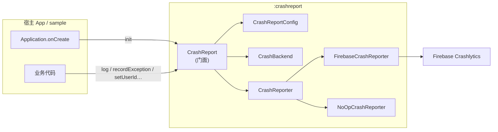
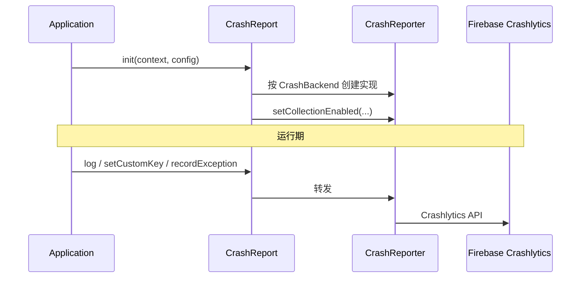

# CrashReportKit

Android 崩溃上报 SDK。业务侧只依赖统一门面 `CrashReport`，底层上报通道可替换。当前临时接入 **Firebase Crashlytics**。

| 模块 | 说明 |
|------|------|
| `:crashreport` | SDK 库（对外 API + Firebase 适配器） |
| `:sample` | 演示 App（初始化、breadcrumb、非致命/致命崩溃） |

- `minSdk` 24 · `compileSdk` / `targetSdk` 37
- 版本目录：`gradle/libs.versions.toml`

---

## 架构

### 模块关系



### 调用链路



### 源码结构

```text
crashreport/src/main/java/com/kit/crashreport/
├── CrashReport.kt              # 对外门面（唯一推荐依赖）
├── CrashReportConfig.kt        # 初始化配置
├── CrashBackend.kt             # 后端枚举（当前仅 FIREBASE）
├── CrashReporter.kt            # 后端契约
└── internal/
    ├── FirebaseCrashReporter.kt  # Firebase 适配（临时）
    └── NoOpCrashReporter.kt      # 关闭采集 / 未初始化兜底
```

设计要点：

1. **门面隔离**：业务只调用 `CrashReport`，不直接依赖 Firebase API。
2. **可替换后端**：新增厂商时实现 `CrashReporter`，并在 `CrashBackend` / `init` 中挂接即可。
3. **可关闭**：`CrashReportConfig(enabled = false)` 或 `setCollectionEnabled(false)` 走空实现 / 停止上报。

---

## 快速开始

### 1. 通过 JitPack 依赖（推荐）

`settings.gradle.kts`：

```kotlin
dependencyResolutionManagement {
    repositories {
        google()
        mavenCentral()
        maven { url = uri("https://jitpack.io") }
    }
}
```

App `build.gradle.kts`：

```kotlin
plugins {
    alias(libs.plugins.android.application)
    alias(libs.plugins.google.services)       // Firebase 必需
    alias(libs.plugins.firebase.crashlytics)  // Crashlytics mapping 上传
}

dependencies {
    // 多模块仓库：指定 crashreport 模块
    implementation("com.github.e-hai.CrashReportKit:crashreport:Tag")
    // 将 Tag 换成 Git tag，例如 1.0.0 或 v1.0.0（与发布 tag 一致）

    implementation(platform("com.google.firebase:firebase-bom:34.17.0"))
    implementation("com.google.firebase:firebase-analytics")
}
```

源码依赖（本仓库开发）：

```kotlin
implementation(project(":crashreport"))
```

根工程需声明插件：

```kotlin
plugins {
    alias(libs.plugins.google.services) apply false
    alias(libs.plugins.firebase.crashlytics) apply false
}
```

### 2. 配置 Firebase

1. 在 [Firebase Console](https://console.firebase.google.com/) 创建项目并添加 Android 应用。
2. 将真实的 `google-services.json` 放到 **application 模块根目录**（覆盖 sample 中的占位文件）。
3. `applicationId` / `package_name` 必须与 JSON 内配置一致。

### 3. 初始化

```kotlin
class MyApplication : Application() {
    override fun onCreate() {
        super.onCreate()
        CrashReport.init(
            context = this,
            config = CrashReportConfig(
                enabled = true,
                collectionEnabled = true,
                backend = CrashBackend.FIREBASE, // 当前默认
            ),
        )
        CrashReport.setUserId("user-123")
        CrashReport.setCustomKey("flavor", "prod")
    }
}
```

`AndroidManifest.xml`：

```xml
<application android:name=".MyApplication" ...>
```

### 4. 业务调用

```kotlin
// 面包屑（崩溃前上下文）
CrashReport.log("Checkout: pay button clicked")

// 自定义键
CrashReport.setCustomKey("order_id", "A10086")
CrashReport.setCustomKey("is_vip", true)

// 非致命异常（不上报后杀进程）
try {
    risky()
} catch (e: Exception) {
    CrashReport.recordException(e)
}

// 仅 Debug / QA：强制致命崩溃
// CrashReport.testCrash()
```

### 5. 运行 Sample

```bash
./gradlew :sample:assembleDebug
```

Sample 提供三个按钮：Log breadcrumb、Record non-fatal、Force fatal crash。  
使用占位 `google-services.json` 时可编译运行；**真实上报**需替换为控制台下载的配置。

---

## 发布到 JitPack

仓库已配置 `maven-publish` + `jitpack.yml`，只发布 `:crashreport`。

| 项 | 值 |
|----|-----|
| GitHub | [e-hai/CrashReportKit](https://github.com/e-hai/CrashReportKit) |
| 坐标 | `com.github.e-hai.CrashReportKit:crashreport:<Tag>` |
| 本地校验 | `./gradlew :crashreport:publishToMavenLocal` |

步骤：

1. 推送代码到 GitHub。
2. 打 tag 并推送，例如：
   ```bash
   git tag 1.0.0
   git push origin 1.0.0
   ```
3. 打开 [jitpack.io/#e-hai/CrashReportKit](https://jitpack.io/#e-hai/CrashReportKit)，选中对应 Tag，等待绿色构建成功。
4. 宿主按上文「通过 JitPack 依赖」接入。

版本号：优先读 JitPack 环境变量 `VERSION`（即 Git Tag，会去掉前缀 `v`）；本地默认用 `gradle.properties` 的 `VERSION_NAME`。

---

## API 一览

| API | 说明 |
|-----|------|
| `init(context, config)` | 初始化，建议在 `Application.onCreate` 调用一次 |
| `setUserId(id)` | 关联用户 |
| `setCustomKey(key, value)` | 自定义维度（String/Boolean/Int/Long/Float/Double） |
| `log(message)` | 面包屑日志 |
| `recordException(t)` | 上报非致命异常 |
| `setCollectionEnabled(bool)` | 运行时开关采集 |
| `testCrash()` | 强制致命崩溃（仅测试） |
| `setReporter(reporter)` | 注入自定义实现（测试 / 自研后端） |

---

## 替换上报后端（预留）

```kotlin
// 1. 实现 CrashReporter
class BuglyCrashReporter : CrashReporter { /* ... */ }

// 2. 扩展 CrashBackend，并在 CrashReport.init 的 when 中创建实例
// 或运行时：
CrashReport.setReporter(BuglyCrashReporter())
```

业务调用点无需修改。

---

## 构建

```bash
export JAVA_HOME="/Applications/Android Studio.app/Contents/jbr/Contents/Home"  # 按本机调整

./gradlew :crashreport:assembleDebug
./gradlew :sample:assembleDebug
./gradlew :crashreport:testDebugUnitTest
./gradlew :crashreport:publishToMavenLocal
```

---

## 许可证

内部工程；按团队规范使用与分发。
